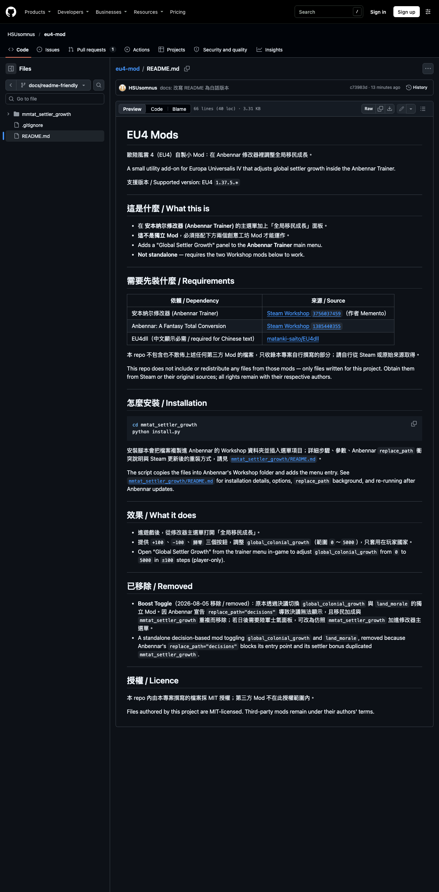

# README 檢查報告｜PR #1

- 倉庫：HSUsomnus/eu4-mod（**公開倉庫**）
- 分支：`docs/readme-friendly`
- 檢查日期：2026-11-18
- 完整紀錄：[check.txt](check.txt)

## 結果

| 項目 | 結果 |
|---|---|
| 站內相對連結（README 與 docs/開發者說明.md） | 2 個，失效 0 個 |
| 外部連結 | 3 個，全部可開（明細見 check.txt） |
| 隱私掃描（家目錄路徑、本機磁碟路徑、非 noreply email、金鑰樣式、session ID、真名／帳號字串） | 0 筆 |
| commit 作者／提交者 | 全部為 HSUsomnus noreply |
| 截圖人工檢視 | 已開圖逐張確認，沒有個資 |

隱私掃描範圍是加入本報告前、本 PR 所有待合併 commit 的新增內容與 commit 資訊。

## README 預覽

GitHub 實際頁面（未登入狀態瀏覽公開倉庫的分支）：

另附 GitHub Markdown API 渲染版：[preview.png](preview.png)
